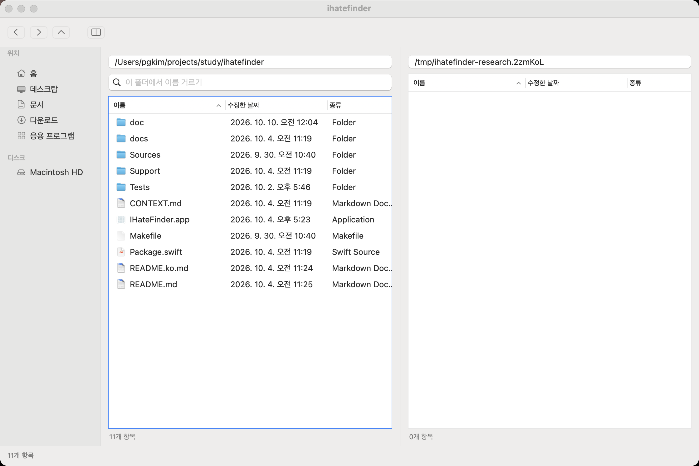

# ULW-Research Synthesis: IHateFinder가 일상 대체품이 되려면

측정 기록: 초기 13개 lane, 확장 counter-audit 2개, fresh refinement 2개와 delta recheck 2개. 수집/확장 wave 3개, excursion EX1 하나. 시간과 출처 합계는 outcome.json/closing briefing을 사용한다. [Source 8]

## 결론

지금 앱은 **정확한 경로를 알고 있는 두 폴더 사이에서 파일을 다루는 도구**로는 꽤 갖춰져 있다. 복사·이동·충돌 처리·취소·실행 취소·Quick Look·현재 폴더 거르기·외부 변경 갱신·마지막 위치 복원이 이미 있다. 아쉬운 쪽은 **내 장소를 다시 찾고, 하던 일을 유지하고, 찾은 파일로 다음 작업을 이어가는 흐름**이다. 기능 수를 더 세기보다 여기를 메우는 편이 네가 말한 ‘0.3 Finder’에 가깝다고 본다. 이건 사용 빈도를 측정한 순위가 아니라 현재 구현과 작업 흐름을 대조한 판단이다. [Source 1][Source 3][Source 5][Source 7]

## 주제별 발견과 개선 판단

**1. 내 폴더를 등록해 두는 기능이 없다.** 사이드바는 홈·데스크탑·문서·다운로드·응용 프로그램과 디스크다. 프로젝트 폴더를 추가하고 순서를 바꿔 계속 쓰는 ‘내 장소’가 없다. 마지막 좌우 위치 복원과 뒤로/앞으로는 있지만, 여러 고정 작업 폴더를 골라 돌아가는 것과는 다르다. 첫 큰 기능을 고르라면 나는 사용자 즐겨찾기를 고르겠다. 주소 자동완성과 최근 폴더 목록은 각각 별도 후속 후보로 둔다. [Source 5][Source 9][Source 12]

**2. 정확한 경로를 기억해야 주소창이 편하다.** 직접 입력과 `~` 확장은 되지만, 폴더 후보를 고르는 앱 전용 완성과 경로의 조상을 눌러 이동하는 표면은 없다. 일부 이름만 기억할 때도 쉽게 도달하게 해야 주소창이 이 앱의 강점이 된다. Finder의 Go to Folder도 경로 후보를 제공한다. [Source 10][Source 13]

**3. 두 곳의 작업은 유지하지만, 세 번째 작업 자리를 만들 수 없다.** 양쪽 창과 마지막 경로·정렬·숨김 상태 복원은 있다. 앱 자체의 새 창·탭 모델은 없다. A/B를 둔 채 C의 선택과 방문 맥락도 붙잡는 일이 불편해질 구조다. 추가 자리와, 기존 자리의 선택·스크롤을 보존하는 개선은 따로 다룰 필요가 있다. 탭·새 창·작업 공간을 모두 만들 필요는 없다. [Source 4][Source 5][Source 17]

**4. 파일 위치를 모르는 순간에는 거르기가 답을 못 준다.** Cmd-F는 현재 폴더의 이름 목록만 줄인다. 이 기능은 실제 화면에서도 확인했다. ‘프로젝트 아래 어디엔가 있는 파일’을 찾는 하위 폴더 검색은 없다. 검색을 넣는다면 결과에 원래 경로를 보여주고, 부모 폴더에서 선택한 뒤 기존 복사·이동으로 이어져야 한다. 범위·취소·읽지 못한 폴더도 설명해야 한다. Spotlight와 자체 재귀 이름 찾기를 한 번에 만들자는 뜻은 아니다. [Source 10][Source 11][Source 14][Source 130]

**5. 이미 잘하는 조작이 화면에 덜 드러난다.** 상단 버튼은 뒤로·앞으로·위·양쪽 창이다. 반대쪽 복사/이동은 F5/F6에 있고 Quick Look도 있지만, 앱 메뉴와 우클릭 메뉴에 직접 명령으로 나오지 않는다. ‘반대쪽 <폴더명>으로 복사 (F5)’, ‘이동 (F6)’, ‘미리보기 (Space)’를 보이게 하면 이 앱을 쓸 이유가 더 분명해진다. Marta가 버튼에 명령과 단축키를 함께 보여주는 것도 참고할 만하다. 실제로 네가 못 찾았다는 관측은 아니고, 표면을 보고 내린 개선 판단이다. [Source 9][Source 10][Source 11][Source 15]

**6. 실패 뒤 다음 행동이 수동 작업으로 남는다.** 진행·취소·부분 결과와 복구 경로는 이미 나온다. 다만 결과는 일회성 텍스트 시트이고, 닫은 뒤 다시 열거나 보존 위치로 이동·선택하고 미처리만 재시도하는 전용 흐름은 없다. 남은 잘라둔 항목을 다시 붙여넣는 재시도는 가능하다. 엔진을 다시 만들기보다 ‘최근 결과 다시 보기 → 실제 위치 열기 → 상태에 맞는 다음 행동’이 필요한 쪽이다. [Source 2][Source 9]

## 나라면 이렇게 진행한다

- **먼저 작은 수정:** 이미 있는 F5/F6·미리보기를 메뉴에 드러내고, ‘찾기’ 메뉴를 현재 폴더 이름 거르기라는 실제 범위에 맞게 표시한다. 확인된 디스크 알림 구독 문제도 별도로 바로잡는다.
- **그다음 기본 선택:** 사용자 즐겨찾기. 등록·삭제·순서·저장까지 끝내고, 최근 폴더나 주소 후보는 별도 개선으로 판단한다.
- **불편한 장면에 따라 순서를 바꾼다:** 파일 이름은 알지만 위치를 모르면 검색이 먼저다. A/B/C를 동시에 붙잡아야 하면 추가 작업 자리가 먼저다. 부분 실패 뒤 복구가 문제라면 결과와 다음 행동을 연결하는 개선이 먼저다.

사진을 내용으로 고르는 일이 중심이면 썸네일이나 상시 미리보기의 순위를 올릴 수 있다. 클라우드·공유·외장 디스크 작업이 중심이면 직접 공유·꺼내기·공급자 상태 표시가 중요해진다. 현재 목록에는 그 전용 표면이 없지만, Quick Look이나 일반 파일 경로를 통한 우회까지 불가능하다는 뜻은 아니다. 원격 연결·내장 터미널·전송 큐·Finder의 모든 보기 방식을 처음부터 묶지는 않겠다. [Source 3][Source 5][Source 9][Source 10][Source 12][Source 15][Source 17][Source 18]

내가 잡을 최소 실용성 기준은 **다운로드에서 파일을 확인하고, 이름을 고쳐 내 프로젝트 장소로 옮기고, 다른 곳을 들렀다가 하던 작업으로 돌아오는 흐름을 이 앱에서 끝내는 것**이다. 위치가 불명확하거나 일부 작업이 실패했을 때도 다음 행동이 보여야 한다. ‘Finder가 한 번도 뜨지 않음’을 목표로 삼을 필요는 없다. 다른 대체 파일 관리자도 시스템 표면의 일부는 남겨 둔다. [Source 4][Source 5][Source 17][Source 18]

## 코드와 실제 표면

- CG01 기반 기능: README.ko.md:108-129, AppDelegate.swift:8-37, WorkspaceStore.swift:3-54. 관련 계약 테스트 240개 pass. 기능의 존재를 모든 환경의 완벽한 안전성으로 일반화하지 않는다. [Source 1][Source 4][Source 5][Source 7]
- CG02/CG03 장소: BrowserWindowController.swift:848-876의 고정 위치/디스크, FilePaneController.swift:72-82의 단일 주소 field. 사용자 장소/최근 picker/폴더 후보/클릭 조상은 다른 결핍이다. [Source 9][Source 10][Source 12][Source 13]
- CG04 데이터 공급은 current session.entries이며 recursive/Spotlight engine이 아니다. 실제 README 이름 거르기는 성공했다. [Source 10][Source 11][Source 14]
- CG05 단일 browser/좌우 state와 영속 path/sort/hidden/dual. OS 암묵 탭 표시와 실제 왕복 스크롤 상태를 실험한 척하지 않는다. [Source 4][Source 5]
- CG06 전체 앱/context/상단 메뉴의 명령 노출 범위를 읽고 현재 screenshot과 대조했다. 실제 사용자의 발견 실패를 측정하지 않았다. [Source 9][Source 10][Source 11][Source 15]
- CG07 BrowserWindowController.swift:437-472는 자세한 selectable text + 확인 버튼이다. 전용 result history/location open/state retry 없음과 ordinary remaining-cut paste retry 가능을 함께 유지한다. [Source 2][Source 9]
- CG08/CG09 직접 목록 Share/tag/eject/provider UX는 scoped absence. clipboard/drag/open/reveal/Terminal/default-viewer 안내는 존재한다. native QL sharing/일반 provider 접근을 불가능으로 확대하지 않는다. [Source 4][Source 6][Source 10][Source 18]

위 화면은 현재 rebuilt debug executable의 실제 macOS native surface다. 주소·목록·두 위치·상단 네 버튼과 거르기 노출을 확인한 근거이며 복사/이동 실행이나 사용자 혼란을 측정한 그림이 아니다. [Source 11]

## 검증된 계약 불일치

디스크 연결/해제 observer가 `NotificationCenter.default`에 붙어 있다. Apple 계약은 `NSWorkspace.shared.notificationCenter`를 요구한다. 별도 Swift probe에서도 두 센터가 다르고 synthetic mount 알림이 workspace 쪽에만 전달됨을 확인했다. **코드와 플랫폼 계약의 불일치는 확인됐지만, 실제 외장 디스크를 연결해 사이드바 장애를 본 것은 아니다.** 위치: `Sources/IHateFinder/BrowserWindowController.swift:78-89`. [Source 9][Source 20][Source 21]

## 주장별 증거와 독립성

CG01-CG12는 claim-graph.md와 claim-nodes.json에 claim type, risk, scope, intent ids, observations, counter-search, source, dependency, supported status와 synthesis location을 기록했다. 정확한 내부 구현 부재에는 소비 경로/메뉴/저장 모델의 primary source exception을 사용한다. 같은 repository의 README와 테스트를 독립 사용자 조사로 세지 않았다. 문서와 코드, 실제 test/desktop modality는 구분했다. 외부 vendor 문서는 제품 계약이지 사용자 효과나 상대 속도의 실측이 아니다. 고위험 시장/재무/법률/계량 인과 주장은 만들지 않았다. [Source 1][Source 4][Source 5][Source 7][Source 11][Source 18]

intent-diff I1의 개인 실제 사용 빈도는 unknown. I2의 기존 기능 누락 가설은 교정 완료. I3의 mount center 계약은 violated이며 물리 incident는 unknown. I4/I5는 기존 제품의 약속을 임의로 늘린 위반이 아니라 최소 실용성 목표와 비교하는 확장 후보다. 이전 /private/var watcher 이슈는 현 코드 canonicalization 때문에 현재 결함 주장에서 제외했다. [Source 2][Source 5][Source 9][Source 20][Source 21]

## 반론 검토와 바뀐 결론

1. 초기 Skeptic: 전체 검색/장소/통합/신뢰 부재라는 넓은 가설 반박. 기존 filter/open/reveal/undo/restore 반례를 채택하고 부재 범위를 좁혔다. [Source 8]
2. WorkflowCounter: favorites+completion+tabs 묶음은 별개 작업을 합친다는 공격. tabs를 첫 묶음에서 제외하고 장소 도달성/독립 context를 분리했다. wave-2-WorkflowCounter.md에 근거. [Source 5][Source 9][Source 10]
3. SafetyCounter: 결과/오류/재시도가 전혀 없다는 해석 반박. 결과 text와 cut retry를 유지하면서 전용 다음 행동 부족만 남겼다. undo는 identity 보호이지 내용 불변 보장이 아니다. wave-2-SafetyCounter.md에 근거. [Source 2][Source 9]
4. Fresh PriorityRefinement: 내 장소/주소 후보/명령 노출도 한 increment로 강제하지 말라는 공격. 첫 작은 개선을 기존 action exposure 하나로 좁히고, 이후 기본 후보를 내 장소로 잡았다. Fresh EvidenceRefinement: fixed order와 synthetic proof를 executed product handler로 오해할 표현을 공격. 두 수정 뒤 새 EvidenceRecheck/ PriorityRecheck 모두 unqualified APPROVE. [Source 8][Source 9][Source 10][Source 21]

## 한계와 미확정 후보

실제 사용 빈도, 대량 폴더/작은 파일 다수의 속도·응답성, 실제 cloud/provider/physical-volume/default-viewer routing은 측정하지 않았다. 드문 source replacement race, alias containment, rename-after-warning undo, interrupted-stage recovery, sort-equivalence, unsupported IDs, subprocess 취소 지연은 정적 후보로만 기록하고 현재 data-loss/hang/성능 실패라고 주장하지 않았다. 외부 issue/message를 작성할 권한은 없어 내부 보고서에 reproduction 후보와 증거 수준을 남겼다. 제품 변경은 하지 않았다. [Source 7][Source 9][Source 10][Source 21]

SourceBrowser backend는 requested fullPage 대신 viewport screenshot만 제공했다. 이 제약을 기록하고 전체 페이지 provenance라고 주장하지 않았다. Apple 기본 /mac URL이 미래 macOS 27 문서를 반환한 오염은 version26 source로 교정했다. 과거 Marta tab blog는 역사적 기능 설명으로만 사용했다. [Source 12][Source 14][Source 15][Source 17][Source 18]

## 확장과 수렴

wave-1-summary.md는 첫 13개 lane의 sources와 EXPAND tails를 보존한다. wave-2-summary.md는 모든 이름 붙은 lead를 조사된 scope/반증/중복/미확정 비주장으로 매핑한다. wave-3-summary.md는 fresh attacks, precise corrections, unqualified delta approvals를 기록한다. 두 확장 라운드를 완료했고 새 조사 lead가 없으며 supported claims가 모두 skeptic pass를 받았으므로 수렴했다. EX1 notification detour는 code/API/one script로 닫혀 top-level answer에 작은 reliability finding을 추가했다. [Source 8][Source 20][Source 21]

## 조사 방법과 검증

관련 테스트는 **240개 모두 통과**했다. 실제 앱에서는 주소 이동·양쪽 창·현재 폴더 거르기를 확인했다. 네 실제 작업 빈도, 대량 폴더 성능, 클라우드와 물리 외장 디스크 동작은 실측하지 않았다. 제품 코드는 바꾸지 않았고 조사용 앱·임시 홈·브라우저 탭·외부 저장소 clone은 정리했다. 자세한 근거는 [조사 보고서](SYNTHESIS.md), [실제 앱 확인](verify-desktop.md), [알림 센터 검증](verify-notification.md)에 있다. [Source 7][Source 11][Source 21]

보고서와 post는 한국어로 작성했고, post의 static gate와 실제 browser render는 outcome.json에서 판정한다. light no-format/chat lane이므로 pagination layout/proofread 전용 gate는 not_run이며 증거/recommendation refinement와는 별개다. 모든 자식은 terminal이고 native app/temp home/browser tabs/clone cleanup receipts는 각 verification/worker report에 기록되어 있다. [Source 7][Source 11][Source 21]

## 출처

- [Source 1] [README.ko.md](../../../README.ko.md)
- [Source 2] [동작 기준](../../../docs/behavior.md)
- [Source 3] [제품 목표](../../../CONTEXT.md)
- [Source 4] [AppDelegate.swift](../../../Sources/IHateFinder/AppDelegate.swift)
- [Source 5] [WorkspaceStore.swift](../../../Sources/IHateFinderCore/WorkspaceStore.swift)
- [Source 7] [실행한 테스트](verify-tests.md)
- [Source 9] [BrowserWindowController.swift](../../../Sources/IHateFinder/BrowserWindowController.swift)
- [Source 10] [FilePaneController.swift](../../../Sources/IHateFinder/FilePaneController.swift)
- [Source 11] [실제 앱 화면과 조작](verify-desktop.md)
- [Source 12] [Apple: 사이드바 사용자 장소](https://support.apple.com/guide/mac-help/customize-the-finder-sidebar-on-mac-mchl83c9e8b8/26/mac/26)
- [Source 13] [Apple: 폴더로 바로 이동](https://support.apple.com/guide/mac-help/go-directly-to-a-specific-folder-on-mac-mchlp1236/26/mac/26)
- [Source 14] [Apple: Finder 검색](https://support.apple.com/guide/mac-help/narrow-search-results-in-finder-mh15155/26/mac/26)
- [Source 15] [Marta: 명령과 단축키](https://marta.sh/docs/core/actions/)
- [Source 17] [QSpace: 작업 공간](https://qspace.awehunt.com/en-us/guide/workspace.html)
- [Source 18] [ForkLift: 공식 매뉴얼](https://binarynights.com/manual)
- [Source 130] [Nimble Commander: 검색 결과에서 다음 작업](https://github.com/mikekazakov/nimble-commander/blob/c6a6f5dbcb7902d7afe5f7ba0f1a4d01a2f2bd17/Source/NimbleCommander/NimbleCommander/States/FilePanels/Actions/FindFiles.mm#L66-L95)
- [Source 20] [Apple: mount 알림 계약](https://developer.apple.com/documentation/appkit/nsworkspace/didmountnotification.md)
- [Source 21] [실행한 synthetic 검증](verify-notification.md)

외부 출처 조회일은 2026-10-10이다. Apple 사용자 문서는 macOS 26으로 고정했고, 대안 문서는 제품의 설명을 확인한 것이지 각 제품의 성능을 실측한 것은 아니다.

완전한 reviewed registry는 sources-ledger.md와 reviewed-sources.json 및 소유 축별 보고서다. 해당 registry는 별개 URL/문서 기록이지 독립 발행자 수나 효과 검증 수가 아니다.
